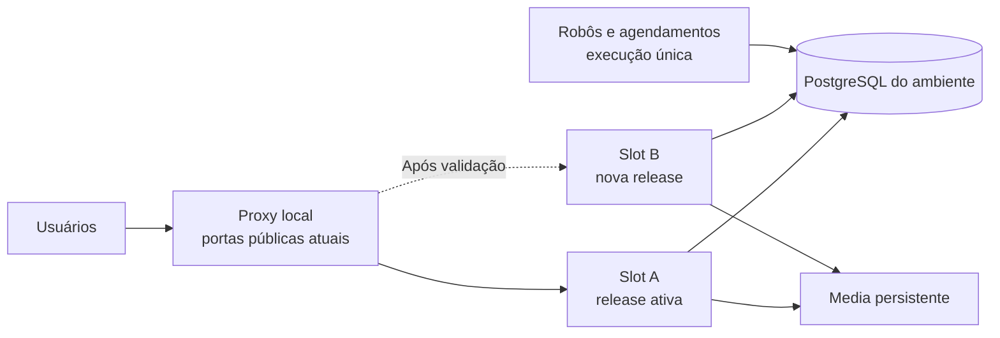

# Plano de deploy com indisponibilidade mínima — PPLID

**Destinatário:** Sol, para implementação por etapas.

**Data:** 26/11/2026.

**Estado:** implementação em validação local; ativação corporativa pendente.

> Execução iniciada: a implementação e o runbook estão em [deploy/BLUEGREEN.md](deploy/BLUEGREEN.md), e as evidências/pendências em [deploy/VALIDACAO_BLUEGREEN.md](deploy/VALIDACAO_BLUEGREEN.md). A configuração de produção continua no modo legado. Este plano registra o objetivo completo; o relatório distingue o que foi implementado, testado e o que ainda depende de homologação.

## 1. Objetivo e contexto

Preparar e iniciar uma nova versão enquanto a atual atende, validar a candidata e trocar o tráfego com interrupção mínima. Aproveitar o pipeline existente, executado em Windows com PowerShell 5.1, sob uma conta sem administrador.

A introdução inicial do proxy exige uma pequena janela planejada. Os deploys seguintes devem ocorrer sem parada perceptível quando código, banco e recursos disponíveis forem compatíveis. Não se pretende fornecer alta disponibilidade contra queda da máquina, do PostgreSQL ou da sessão do usuário.

O pipeline atual já faz build separado da versão ativa. A promoção executa migrações, para os serviços, troca a junction `current` e inicia a nova versão. O objetivo principal é substituir essa parada por inicialização antecipada e troca de tráfego.

## 2. Instruções de execução para o Sol

- Inspecionar `PPLID-server-ops` e o repositório da aplicação `PPLID`, incluindo instruções locais aplicáveis.
- Preservar alterações locais existentes e separar commits por etapa.
- Desenvolver e testar em diretórios, portas e banco isolados.
- Não executar deploy, migração, limpeza, parada ou testes de falha contra MAIN durante o desenvolvimento.
- Não habilitar DEV ou HOM automaticamente: ambos estão desabilitados na configuração versionada examinada.
- Não instalar serviços Windows, alterar firewall, usar `netsh portproxy` ou exigir administrador.
- Não publicar, fazer merge ou ativar em produção automaticamente.
- Entregar implementação, testes, evidências e procedimento de implantação para revisão antes da ativação.
- Registrar testes executados, resultados e limitações. Identificar claramente testes bloqueados ou não executados.
- Não tratar este documento como autorização para mudanças no servidor de produção.
- Não substituir apenas os números de porta atuais: distinguir entrada pública de portas internas dos slots.

## 3. Arquitetura pretendida

Uma entrada HTTP estável, executada como processo do usuário, encaminha tráfego para um dos dois slots de cada ambiente. O proxy é independente do Ops Console.



Cada slot contém backend e frontend da mesma release. Processos executam pelo **caminho físico da release**, como `releases/<sha>`, sem depender da junction mutável `current`. Trocar a junction não pode mudar os arquivos lidos por um processo antigo.

Preservar as portas públicas existentes:

| Ambiente | Branch | Backend público | Frontend público | Banco | Habilitado no arquivo examinado |
|---|---|---:|---:|---|---|
| MAIN | main | 8000 | 5173 | pplid_main | Sim |
| DEV | dev | 8001 | 5174 | pplid_dev | Não |
| HOM | hom | 8002 | 5175 | pplid_hom | Não |

As portas internas A/B serão configuráveis e reservadas após verificar conflitos. Os listeners internos devem usar `127.0.0.1`. A configuração local efetivamente carregada deve ser conferida antes de qualquer execução.

### Escolha do proxy

Realizar prova de conceito antes de definir a tecnologia. Preferir implementação madura com suporte documentado a Windows, execução sem instalação administrativa, atualização de rotas sem interromper listeners e conexões, e manutenção previsível.

Consultar a documentação oficial da versão escolhida. Registrar versão, origem, configuração, mecanismo de atualização e limites de drenagem. Não implementar um proxy HTTP próprio dentro do console.

O proxy único continua sendo um ponto de falha. Sua atualização e recuperação precisam de procedimento próprio.

## 4. Etapa 1 — Diagnóstico completo

| Área | Verificar |
|---|---|
| Inicialização | Seleção de portas, diretórios e processos em `start_env.ps1`, `start_backend.ps1` e `start_frontend.ps1`. |
| Encerramento | Se scripts e console encerram processos por porta, nome ou árvore de processos. |
| Backend | Servidor Python utilizado, workers, parada graciosa e efeitos colaterais de inicialização. |
| Frontend | Vite, proxy da API, URLs embutidas no build, assets e lazy loading. |
| Autenticação | Sessões, chaves, cookies, CSRF, hosts e origens confiáveis. |
| Conexões | WebSocket, SSE, uploads, downloads e requisições demoradas. |
| Robôs | Processos iniciados junto ao backend e supervisores independentes. |
| Persistência | Media, static, caches, arquivos temporários e configurações compartilhadas. |
| Banco | Migrações pendentes, locks e compatibilidade entre versões simultâneas. |
| Recursos | Memória, CPU, disco, consumo por processo e permissões reais. |
| Operação | Tasks instaladas, usuário de execução e configuração local carregada. |

### Pontos do repositório a revisar

- `deploy/promote_release.ps1`
- `deploy/rollback_release.ps1`
- `deploy/bootstrap_env.ps1`
- `deploy/deploy_pipeline.ps1`
- `deploy/run_pipeline_locked.ps1`
- `deploy/watch_github.ps1`
- `deploy/cancel_deploy.ps1`
- `deploy/lib/deploy_state.ps1`
- `deploy/lib/env_spec.ps1`
- `deploy/lib/deploy_paths.ps1`
- `deploy/lib/shared_env.ps1`
- `deploy/lib/release_cleanup.ps1`
- `deploy/prune_releases.ps1`
- `ops-console/server_ops.py`
- `ops-console/server.py`
- `lib/orphan_bot_cleanup.*`
- `lib/paths.ps1`
- Tasks e scripts de bootstrap, parada e recuperação.

### Dependências externas essenciais

Inspecionar no repositório da aplicação `scripts/deploy/lib.ps1`, `start_env.ps1`, `stop_env.ps1`, `start_backend.ps1`, `start_frontend.ps1`, `health_check.ps1` e os helpers por eles usados.

Não considerar o levantamento completo apenas com este repositório de operações.

### Achados já identificados

- A promoção atual aplica migrações antes de parar os serviços.
- O bootstrap também aplica migrações, inclusive quando o backend já está ouvindo.
- Algumas ações do console operam diretamente sobre as portas públicas atuais.
- O pipeline executa limpeza de robôs órfãos antes do deploy.
- `deploy_all.ps1` encaminha para `bootstrap_all.ps1`.
- `update_all.ps1` encaminha para `watch_all.ps1`.
- O watcher é chamado a cada dois minutos; o XML de deploy ao logon configura atraso de cinco minutos.
- As tasks usam sessão interativa do usuário.

Esses caminhos precisam reconhecer os slots para não interromper a versão ativa, matar o proxy ou interpretar a candidata como órfã.

**Entrega:** diagnóstico do fluxo real e decisões técnicas. Não avançar para ativação sem conferir os scripts da aplicação.

## 5. Etapa 2 — Prova de conceito do proxy

Montar laboratório com dois servidores HTTP simples, A e B, identificáveis na resposta.

Verificar:

1. Inicialização sob a conta comum.
2. Encaminhamento das duas entradas públicas simuladas.
3. Troca de destino sem reiniciar o listener.
4. Conclusão de requisição demorada iniciada antes da troca.
5. Rejeição de configuração inválida com preservação da anterior.
6. Consulta à configuração efetivamente ativa.
7. Interface administrativa restrita ao acesso local e protegida adequadamente.
8. Preservação de cookies, redirecionamentos, corpos e códigos HTTP.
9. Suporte aos protocolos usados pela aplicação.
10. Ausência de repetição automática de operações de escrita após falha ambígua.
11. Tratamento correto de headers encaminhados, sem confiar indiscriminadamente em headers fornecidos pelo cliente.

Frontend e backend devem mudar de forma coerente. Se o proxy não aplicar ambas as rotas em uma atualização única, documentar e testar a janela intermediária.

**Critério de avanço:** alternar A → B → A sob tráfego contínuo sem erros e sem encerrar a requisição longa.

Se políticas corporativas impedirem o mecanismo necessário, documentar o bloqueio antes de desenvolver o restante. A alternativa será otimizar o restart existente com indisponibilidade curta e medida.

## 6. Etapa 3 — Configuração e estado dos slots

Adicionar estratégia por ambiente:

- `legacy`: comportamento atual; padrão inicial.
- `blueGreen`: novo comportamento.

Separar configurações:

| Campo conceitual | Finalidade |
|---|---|
| Portas públicas | Endereços de usuários e integrações. |
| Portas internas A/B | Destinos exclusivos dos slots. |
| Timeout de inicialização | Prazo para readiness da candidata. |
| Janela de observação | Monitoramento após a troca. |
| Prazo de drenagem | Espera por requisições antigas. |
| Política de migração | Condições de compatibilidade para deploy online. |
| Limites de recursos | Condições mínimas para iniciar outra instância. |

Persistir estado com versão de esquema:

- Slot ativo e candidato.
- SHA completo, caminho físico e portas de cada instância.
- Identidade dos processos: PID, horário de criação e executável, quando disponível.
- Fase, run ID e versão da configuração de roteamento.
- Última release comprovadamente saudável.
- Horários de promoção, observação, drenagem e conclusão.

PID isolado não é identidade suficiente, pois pode ser reutilizado.

Usar escrita segura de estado e preservar informação de recuperação. Toda alteração de tráfego deve respeitar o mesmo lock do ambiente, inclusive deploy, rollback, cancelamento, restart, bootstrap e mudança de portas.

Não assumir atomicidade conjunta entre proxy, arquivo de estado e junction. Registrar intenção e confirmação e definir recuperação para cada ponto intermediário.

## 7. Etapa 4 — Processos por slot

Adaptar scripts de inicialização para parâmetros explícitos de ambiente, slot, release física, portas internas, modo web e identificador da instância.

Requisitos:

- Iniciar B não modifica configurações ou processos de A.
- Parar B preserva A, proxy, console e robôs.
- Configuração da candidata não sobrescreve o ambiente efetivo de A.
- O modo web da candidata não inicia automações ou schedulers duplicados.
- Logs e arquivos de PID são separados por instância.
- A versão anterior fica disponível durante observação e rollback aquecido.
- Encerramento prioriza parada graciosa.
- Encerramento forçado exige identidade comprovada, timeout e registro do motivo.
- Memória e disco são verificados antes de iniciar uma segunda instância.

## 8. Etapa 5 — Novo fluxo de promoção

```text
Preparar
→ Build
→ Validar artefatos
→ Verificar recursos e compatibilidade do banco
→ Aplicar migrações compatíveis, quando necessárias
→ Iniciar candidata
→ Validar candidata diretamente
→ Trocar tráfego
→ Validar pelos endereços públicos
→ Observar
→ Drenar versão anterior
→ Encerrar versão anterior
→ Finalizar estado e retenção
```

Readiness precisa comprovar funcionamento e identidade da release; uma porta aberta ou resposta HTTP genérica não basta. Validar dependências essenciais e rotas representativas sem disparar efeitos de negócio.

| Situação | Resultado obrigatório |
|---|---|
| Build falha | A continua atendendo. |
| Porta interna ocupada | Falhar sem parar A ou matar o ocupante da porta. |
| Recursos insuficientes | Recusar/adiar antes de iniciar a candidata. |
| Readiness falha | Encerrar apenas a candidata; preservar A. |
| Migração incompatível | Bloquear promoção online e indicar procedimento necessário. |
| Proxy recusa configuração | Preservar o tráfego em A. |
| B falha após a troca | Retornar a A se saudável e compatível com o banco. |
| Cancelamento antes da troca | Remover candidata e preservar A. |
| Cancelamento após a troca | Aplicar política explícita de reversão ou finalização segura. |

Definir como reconhecer regressão após a troca sem provocar alternância contínua entre slots. Registrar o motivo e limitar tentativas automáticas.

A junction `current` permanece como apontamento operacional e de compatibilidade. A troca de tráfego é responsabilidade do proxy.

## 9. Banco, sessões e arquivos

### Migrações

Usar expansão e contração:

1. Adicionar estruturas compatíveis.
2. Publicar código que suporta a transição.
3. Migrar dados de forma controlada.
4. Remover estruturas antigas em entrega posterior, fora da janela necessária ao rollback.

Requisitos:

- Serializar migrações por ambiente.
- Definir limites de espera por locks e execução quando apropriado.
- Testar o código antigo contra o esquema atualizado.
- Impedir migração automática concorrente nos dois slots.
- Rever o bootstrap para não modificar silenciosamente o banco durante recuperação.
- Não considerar `migrate --plan` prova de compatibilidade ou de baixo impacto.
- Não classificar migração como segura apenas pelo nome da operação.
- Mudanças destrutivas ou de alto bloqueio exigem procedimento específico.

Rollback de código não reverte banco. Bloquear reversão automática incompatível e fornecer diagnóstico. Não executar reversão destrutiva do banco como tratamento genérico de falha.

### Sessões

Preservar chaves e armazenamento compatíveis entre slots. Testar cookies, login, navegação e POST com CSRF durante a troca.

### Frontend e static

Resolver o caso de uma aba antiga solicitar um chunk JavaScript após o deploy. Preservar assets versionados pelo período definido, sem sobrescrever conteúdo de mesmo caminho.

Verificar o efeito de `collectstatic` sobre a release ainda ativa. Testar lazy loading, cache e redirecionamentos.

Clientes antigos podem acessar a API nova mesmo com troca simultânea de frontend/backend. Definir janela de compatibilidade da API.

### Media e configuração

Compartilhar uploads persistentes com semântica compatível. Separar configuração específica de slot de segredos/configuração comum. Não registrar segredos em logs ou relatórios.

## 10. Robôs e agendamentos

Na primeira entrega, manter a execução de automações independente da promoção web:

- Preservar uma única execução dos robôs.
- Desativar inicialização automática de robôs na candidata web.
- Fazer limpeza de órfãos reconhecer instâncias registradas.
- Verificar compatibilidade dos robôs atuais com migrações aplicadas.
- Documentar atualização de robôs que dependam de uma nova release.

Se houver transferência entre versões, usar exclusão mútua e confirmação de encerramento. Não prometer execução exatamente uma vez sem idempotência e mecanismos apropriados.

## 11. Console, bootstrap, retenção e recuperação

### Console

Exibir release que atende, candidata, fase real, saúde do proxy e da aplicação, resultado da promoção/rollback e tempos medidos.

Rever redeploy, rollback, cancelamento, restart de serviços, habilitação/desabilitação, alteração de portas e limpeza. Botões não podem matar o proxy por ocupar uma antiga porta de aplicação.

Atualizar o monitoramento para distinguir listener do proxy disponível de backend realmente saudável.

### Bootstrap e recovery

1. Adquirir lock.
2. Ler o estado persistido.
3. Inspecionar processos e roteamento efetivos.
4. Recuperar uma release válida.
5. Garantir readiness antes de encaminhar tráfego.
6. Retomar ou concluir promoção interrompida com regras determinísticas.

Ensaiar interrupção do orquestrador em todos os pontos de mudança de estado. Se a evidência for ambígua, preservar processos válidos e bloquear mutações perigosas com diagnóstico.

### Retenção

Proteger releases ativas, candidatas, em drenagem, necessárias para rollback e para assets antigos. Não remover diretório usado por processo vivo.

### Limites operacionais

Atualização/restart do console deve preservar o proxy e a aplicação. Recuperação do proxy deve ser testada separadamente. As tasks dependem de sessão interativa; logoff e reboot não são cobertos pela promessa de deploy sem interrupção.

## 12. Matriz de testes obrigatórios

Testes de falha e destrutivos somente em laboratório ou ambiente isolado.

| ID | Teste | Aceite |
|---|---|---|
| T01 | Configuração antiga sem campos novos | Modo legado continua funcional. |
| T02 | Ambiente desabilitado | Nenhum processo ou deploy iniciado. |
| T03 | Conflito de portas | Falha clara; processo existente preservado. |
| T04 | Iniciar A e B | Releases, diretórios e portas corretos. |
| T05 | Parar B | A, proxy, console e robôs continuam ativos. |
| T06 | PID reutilizado | Processo alheio preservado. |
| T07 | Falha de build/dependências | Tráfego atual sem interrupção. |
| T08 | Readiness falha ou demora | Candidata não recebe tráfego. |
| T09 | Health retorna SHA errado | Promoção bloqueada. |
| T10 | Troca sob carga | Sem erros atribuíveis à troca na carga homologada. |
| T11 | Requisição longa iniciada em A | Conclui em A após novos acessos passarem a B. |
| T12 | Keep-alive, upload e download | Sem truncamento ou encerramento indevido. |
| T13 | WebSocket/SSE, se usados | Drenagem/reconexão comprovada. |
| T14 | Login e POST com CSRF | Sessão válida após troca. |
| T15 | Aba antiga e lazy loading | Assets disponíveis e tela funcional. |
| T16 | Cliente antigo chamando API | Compatibilidade na janela definida. |
| T17 | Acesso direto ao backend e `/falhas/` | Portas públicas e rotas preservadas. |
| T18 | B falha após promoção | Retorno a A com tempo medido. |
| T19 | Configuração inválida do proxy | Configuração anterior preservada. |
| T20 | Orquestrador encerrado em cada fase | Recuperação coerente sem perder release válida. |
| T21 | Estado parcial/corrompido | Recuperação ou bloqueio seguro com diagnóstico. |
| T22 | Dois deploys simultâneos | Apenas um altera o ambiente. |
| T23 | Deploy concorrente com rollback/restart | Ações serializadas. |
| T24 | Cancelar antes e depois da troca | Política respeitada; estado consistente. |
| T25 | Migração aditiva | Versões antiga e nova funcionam juntas. |
| T26 | Migração incompatível | Promoção online bloqueada. |
| T27 | Migração esperando lock | Timeout controlado e impacto medido. |
| T28 | Falha de migração | Candidata inválida não publicada; banco diagnosticado. |
| T29 | Robôs durante deploy | Nenhuma execução duplicada. |
| T30 | Limpeza de órfãos e retenção | Processos e releases protegidos preservados. |
| T31 | Recursos insuficientes | Deploy recusado antes de comprometer A. |
| T32 | Queda do proxy | Recuperação medida e destino correto restaurado. |
| T33 | Reboot/logon no laboratório | Recuperação sem rebuild ou robôs duplicados. |
| T34 | Atualização/restart do console | Aplicação continua atendendo. |
| T35 | Promoção entre ambientes | URLs, banco, portas e configuração do destino corretos. |
| T36 | Retorno ao modo legado | Procedimento ensaiado e parada registrada. |

### Camadas de cobertura

- **Unitários:** configuração, estados, locks, escolha de slot e decisões de recuperação.
- **Integração:** processos reais, proxy, portas, drenagem e injeção de falhas.
- **Aplicação:** Django, banco isolado, autenticação e frontend.
- **Navegador:** sessão, navegação, assets e operações representativas.
- **Operacionais:** tasks Windows, permissões, logon e execução sem administrador.

Mocks não substituem os testes reais de processos no Windows. Executar também os testes existentes afetados, especialmente os de deploy, portas, monitoramento, reinício e limpeza de órfãos. Descobrir os comandos corretos a partir das ferramentas e dependências reais dos repositórios.

## 13. Medição e critérios de aceite

Criar coletor independente do pipeline com timestamp, endpoint, status/erro de transporte, latência, SHA/instância e identificador da operação.

Medir separadamente:

1. Candidata diretamente.
2. Endereço público através do proxy.
3. Acesso de outra máquina da rede corporativa, quando disponível.

Iniciar sondas antes do build e mantê-las até depois da drenagem. Frequência inicial sugerida: cinco requisições por segundo por endpoint leve, ajustada para não saturar o ambiente.

Adicionar operações representativas em frequência menor. Escritas somente em dados isolados, com identificadores que permitam detectar duplicação. Não repetir automaticamente POSTs em caso de resposta perdida.

| Indicador | Meta inicial de homologação |
|---|---|
| Deploy saudável | Zero erros atribuíveis à troca na amostra. |
| Falha antes da troca | Zero interrupções da versão ativa. |
| Mudança de rota | Até 1 segundo, a confirmar na prova de conceito. |
| Latência p95 | Regressão de até 20% contra referência sob mesma carga. |
| Rollback aquecido | Até 10 segundos após a decisão de reverter. |
| Requisições longas | Concluir no prazo de drenagem configurado. |
| Duplicação de tarefas | Zero ocorrências nos cenários ensaiados. |

São metas propostas, não resultados comprovados. Registrar tempo de detecção da falha separadamente do tempo de execução do rollback.

Registrar intervalo de amostragem: zero falhas observadas não prova ausência absoluta de interrupções menores que esse intervalo.

Executar ao menos dez alternâncias consecutivas A/B e teste prolongado cobrindo deploy, rollback e navegação de sessão antiga. Definir carga representativa após medir a utilização real.

## 14. Implantação gradual

| Fase | Ação | Condição para avançar |
|---|---|---|
| 1 | Diagnóstico e escolha do proxy | Dependências e limitações documentadas. |
| 2 | Laboratório HTTP simples | Troca e drenagem aprovadas. |
| 3 | Aplicação com banco isolado | Testes funcionais e de falha aprovados. |
| 4 | DEV ou HOM autorizado | Funcionamento corporativo validado. |
| 5 | Ensaio da migração inicial | Procedimento e retorno ao legado cronometrados. |
| 6 | Preparação de MAIN | Artefatos, configuração e evidências prontos para revisão. |
| 7 | Ativação inicial de MAIN | Janela e ativação expressamente autorizadas. |
| 8 | Deploys acompanhados | Métricas e rollback confirmados. |

### Migração inicial de MAIN

1. Preparar a versão atualmente publicada em um slot interno.
2. Validá-la sem iniciar robôs duplicados.
3. Preparar e validar o proxy em portas de teste.
4. Controlar gatilhos automáticos para evitar deploy concorrente.
5. Na janela autorizada, liberar as portas públicas atualmente ocupadas.
6. Iniciar o proxy nessas portas apontando para a mesma versão já validada.
7. Validar acessos local e pela rede.
8. Restaurar gatilhos conforme o procedimento.
9. Somente depois publicar uma nova versão pelo novo fluxo.

A primeira mudança introduz o proxy com a **mesma versão da aplicação**, reduzindo variáveis de diagnóstico.

Se falhar, parar somente o novo proxy e restaurar a inicialização anterior nas portas públicas. Ensaiar esse retorno previamente. Voltar ao modo legado não é equivalente ao rollback aquecido e pode exigir parada.

## 15. Entregáveis

- Implementação nos dois repositórios, conforme necessário.
- Contrato de compatibilidade entre scripts de operações e da aplicação.
- Estratégia legada como padrão inicial.
- Proxy com versão fixada e execução documentada sem administrador.
- Start/stop por slot e identidade segura de processos.
- Promoção, observação, drenagem, rollback e recuperação.
- Política explícita para migrações, sessões, assets e robôs.
- Console e monitoramento atualizados.
- Laboratório reproduzível e testes automatizados.
- Relatório de testes com executados, falhas, pendências e evidências.
- Medições de latência, erros, troca, detecção e rollback.
- Runbook de ativação e retorno ao legado.
- Restrições e riscos residuais documentados.

## 16. Definição de pronto

A implementação está pronta para ativação quando uma nova release puder ser construída, iniciada, validada, promovida e revertida em ambiente homologado, com evidência de continuidade de atendimento, preservação de sessões e ausência de tarefas duplicadas.

O ambiente deve se recuperar de interrupção do orquestrador sem depender de edição manual de JSON. O procedimento de implantação inicial e retorno ao legado deve ter sido ensaiado. Nenhuma meta deve ser declarada cumprida sem evidência.

Ordem recomendada:

**Diagnóstico → prova de conceito do proxy → isolamento dos processos → estado e recuperação → promoção → banco/arquivos/sessões/robôs → console → testes completos → implantação gradual.**
